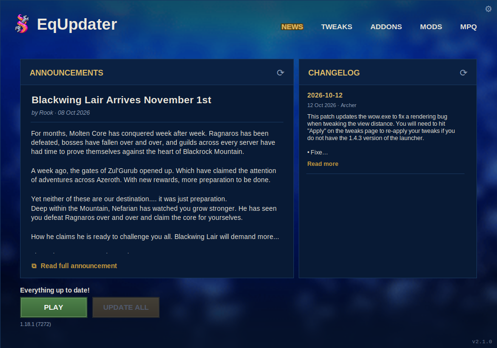

<p align="center">
  
</p>

<h1 align="center">EqUpdater</h1>

<p align="center">
  A desktop updater and mod manager for <b>OctoWoW</b>, on <b>Windows and Linux</b>.<br>
  Game client, DLL mods, addons, texture packs, client tweaks and server news, in one place.
</p>

<p align="center">
  
</p>

---

## Download

- [**Windows**](https://github.com/Equadis/EqUpdater/releases/latest/download/EqUpdater-Windows.exe) — `EqUpdater-Windows.exe`
- [**Linux x86_64**](https://github.com/Equadis/EqUpdater/releases/latest/download/EqUpdater-Linux-x86_64.AppImage) — `EqUpdater-Linux-x86_64.AppImage`
- [**Release page**](https://github.com/Equadis/EqUpdater/releases/latest) — release notes and every version

These links always download the newest release. The current one is
**v2.1.3**:
[`EqUpdater-v2.1.3-Windows.exe`](https://github.com/Equadis/EqUpdater/releases/download/v2.1.3/EqUpdater-v2.1.3-Windows.exe) ·
[`EqUpdater-v2.1.3-Linux-x86_64.AppImage`](https://github.com/Equadis/EqUpdater/releases/download/v2.1.3/EqUpdater-v2.1.3-Linux-x86_64.AppImage).
The release page has every version.

Nothing else is needed: no Python, no build tools.

> **Windows Defender may wrongly flag the unsigned installer as
> `Trojan:Win32/Wacatac.B!ml`.** That is a known false positive for new,
> unsigned apps. If the download is blocked: **Windows Security → Virus &
> threat protection → Protection history**, open the entry, **Actions →
> Allow on device**, and download it again. If Windows says "Windows
> protected your PC", choose **More info → Run anyway**.

## Install

### Windows

1. Download **`EqUpdater-Windows.exe`** (link above).
2. Run it. It installs EqUpdater to
   `%LOCALAPPDATA%\Programs\EqUpdater`, adds it to the Start menu (and,
   if you like, the desktop), and starts it.

No administrator rights are needed, it never touches your game folder, and
it works with non-English user names and folder names.

**Updating:** download `EqUpdater-Windows.exe` again and run it
(close EqUpdater first). It replaces the app in that same place and points
every EqUpdater shortcut there. Your settings, managed mods and addons, and
backups live separately in `%LOCALAPPDATA%\EqUpdater` and are kept. If
anything goes wrong part-way, the version you had stays in place.

### Linux

1. Download **`EqUpdater-Linux-x86_64.AppImage`** (link above).
2. Make it executable and run it:

   ```sh
   chmod +x EqUpdater-Linux-x86_64.AppImage
   ./EqUpdater-Linux-x86_64.AppImage
   ```

EqUpdater runs natively on Linux (x86_64; Ubuntu 22.04 and newer, Mint,
Fedora, Arch and others). The AppImage carries everything it needs,
including the `aria2c` the client download uses. Settings live in
`~/.local/share/EqUpdater`. **Updating:** download the newer AppImage and
run that one instead.

The OctoWoW client itself is a Windows program, so **PLAY needs a way to
run Windows games: Wine, Proton or UMU.** By default EqUpdater uses `wine`
if it is installed, otherwise `umu-run`. To use anything else - a
particular Proton, Lutris, Faugus, a custom Wine prefix - open
**Settings → Game launcher**:

- **Launch command** - the command that starts the game. `{exe}` stands
  for the path of `WoW.exe` (or `VanillaFixes.exe`); without `{exe}` the
  path is added at the end. `{dir}` is the game folder. Examples:
  `wine`, `gamemoderun wine {exe}`, `umu-run`,
  `/path/to/proton run`.
- **Wine prefix** - passed as `WINEPREFIX`; leave it empty for the default.
- **Environment variables** - one `NAME=value` per line, for example
  `DXVK_HUD=fps` or `PROTON_LOG=1`. They are given to the game only, when
  PLAY starts it, and win over anything set above. Spaces and `=` are part
  of the value. A line EqUpdater cannot use is pointed out straight away,
  and PLAY will not start the game until it is fixed.

Nothing is run through a shell, so EqUpdater does what a shell would with
the Wine prefix, the variables and the launch command: `~`, `$HOME` and
`${HOME}` (or any other variable, including one from a line above) become
their values, and one pair of quotes around a whole value is dropped -
`"$HOME/Games/pfx"` is `/home/you/Games/pfx`. A path with spaces needs no
quotes. Before starting, PLAY checks that the runner is on `PATH`, that the
prefix is a full path and that a `PROTONPATH` folder exists; a runner that
quits with an error right away is reported, its output kept in
`last-launch.log` next to the config.

The game runs on its own: closing EqUpdater never closes it. It gets your
desktop session as EqUpdater got it, without EqUpdater's own launch details
(the desktop's startup ID and the AppImage's variables), so its window is
its own in the taskbar. If a game started through Bottles or another
launcher still shows only in Alt+Tab, start the same command from a
terminal: if it behaves the same there, it is that launcher's or the
window manager's setting (for example a Wine virtual desktop), not
EqUpdater's.

Linux tells `Interface/AddOns` and `Interface/Addons` apart; Windows and
Wine do not. EqUpdater finds the addons folder in whatever case it has and
names it `Interface/AddOns`. If a game folder has two of them, everything
only one holds is moved into `AddOns`, and for an addon both hold with
different files you choose which copy to keep -- the other is moved into an
`AddOns-conflicts-...` folder, never deleted. Settings copied from a Wine
install keep their addon and mod records.

Everything else - updates, mods, addons, texture packs, tweaks, the
`WoW.exe` patch - works the same as on Windows. Keep the game anywhere,
for example `~/Games/OctoWoW` or inside a Wine prefix.

---

## Safe by design

**EqUpdater only automatically updates what it manages.** It will never
silently overwrite:

- addons or mods you installed yourself
- a newer version than the one being offered
- files you have edited
- a different fork or source than the one you chose
- anything it cannot verify

When it holds something back, it says why. When you deliberately replace or
downgrade something, it asks first and keeps a backup.

### Managed and unmanaged

- **Managed** — installed by EqUpdater, or handed over with **Manage**.
  Checked for updates and included in **Update All**.
- **Unmanaged** — installed by hand. Shown and left exactly as it is, until
  you choose to manage it.

**Update All** updates everything managed where a newer version can be
confirmed, and skips the rest.

---

## Features

### Game client
- Downloads, verifies and repairs the OctoWoW client, repairing only the
  files that are actually wrong.
- Will not update or patch while the game is running.
- Optional: keep a custom `speech.mpq` (MPQ tab → **Ignore speech.mpq**).
- A new install suggests `Games\OctoWoW` in your user folder, outside
  EqUpdater's own folder, so an EqUpdater update can never touch the game.
- Downloads always use verified HTTPS, under Wine too; certificate checks
  are never switched off.

### DLL mods
- VanillaFixes, ClassicAPI, Nampower, SuperWoW, UnitXP_SP3, VanillaHelpers,
  DXVK, TransmogFix, AuctionQueryThrottle, OctoLogin and more, each with its
  description and latest version.
- **OctoLogin** by Mustafa Yaman (fmustafayaman, MIT) connects the game to
  whichever OctoWoW login server answers first and picks the world server
  with the lowest ping. Its own repository is no longer online, so its last
  release is hosted unchanged at
  [Equadis/OctoLogin](https://github.com/Equadis/OctoLogin).
- **Recommended mods are opt-in** — you are asked once, on first run.
- DLLs already in your client are never replaced just because EqUpdater
  recognises them.
- `dlls.txt` is kept in step and in the right load order, so an enabled mod
  always actually loads.
- **Custom git mods** (Mods → **+ Add custom git mod**): paste a GitHub,
  Codeberg or OctoWoW Git repository or release link and pick a file from
  its latest release:
  - a `.dll` is installed to `mods/` and registered in `dlls.txt`;
  - a `.zip` is unpacked into the game folder (its own top folder dropped),
    and a single mod DLL in it is registered in `dlls.txt` -- a mod needs no
    DLL at all;
  - an `.mpq` goes to `Data/`.

  It is kept updated from that release (a new version's file name is found
  too) and removed cleanly with ✕, the folders it emptied included. A ZIP is
  looked through first and the warning says what goes where; one that would
  write outside the game folder, carries a program, or overwrites another
  mod's files or the game's own `Data` files is refused. A mod can change
  how the game behaves, so nothing is installed until you confirm — only add
  mods you trust.

### Addons
- ★ **Recommended** addons, a wider list of maintained community versions,
  and search.
- Add any addon from **GitHub, GitLab, Gitea, Codeberg and OctoWoW Git**
  (`https://octowow.st/git/<owner>/<repo>`). OctoWoW Git links written
  without `https://`, or on its other address `git.octowow.st/git/...`, are
  read as that same canonical link; no other address is rewritten.
- Knows the difference between newer, older and modified — a different
  commit is not assumed to be an update.
- Switch an addon to another fork, ignore updates for one, or stop managing
  it. One-click **Update All**.
- A failed install or update says why (for example the host's DDoS check,
  a timeout or a bad download), and the installed copy stays untouched until
  its replacement is in place.
- Installing, updating or removing an addon keeps your place in the list.

### Texture packs (MPQ)
- Install packs such as **Octo Raid Visuals** by Rook.
- **Link a source** for a pack you installed yourself, so it can be checked
  for updates: a GitHub, Codeberg or OctoWoW Git release, or a
  dl.octowow.st link. Linking changes no files.
- **Replace** keeps your old file beside the new one.

### Tweaks
- Patched into `WoW.exe`: Auto Loot, Nameplate Range, Field of View, Far
  Clip, Frill Distance, Camera Distance, Sound in Background, **Sound
  Channels** (12–64) and the game's language.
- **Reset** asks before putting everything back to defaults.

### Login Doctor
- **Settings → Troubleshooting → Login Doctor** checks what on your computer
  could stop the game logging in: `WoW.exe` and its build (1.18.1, 7272),
  the realmlist files (`realmlist.wtf`, and `Data/<locale>/realmlist.wtf`
  where there is one), the login lines in `WTF/Config.wtf`, OctoLogin, name
  lookups for play.octowow.st, octowow.st and dl.octowow.st, the login
  server's port (3724) and the HTTPS servers EqUpdater uses. It never tries
  to log in and never reads accounts, launcher sign-ins or tokens.
- **Repair login configuration** sets the realmlist to `play.octowow.st` and
  removes a stale `SET realmList` from `Config.wtf`. It lists the files
  first, refuses while the game is running, changes only those lines, and
  keeps a copy of each file as `<file>.octobak` (an existing copy is never
  replaced).
- If nothing local is wrong it says so: the problem is then on the server or
  the account. If login stops at "Authenticating", turn off any VPN or
  proxy; if normal login still fails, try launching the game through the
  official OctoLauncher using Priority Sign In. EqUpdater cannot use Priority
  Sign In itself.

### News
- Announcements: every topic in OctoWoW's
  [Announcements forum](https://octowow.st/forum/viewforum.php?f=2), newest
  first, ten at a time with **Load more**. The newest is open; click any
  title to open or close its post. While the forum is unreadable, OctoWoW's
  public news feed (`news.json`) stands in.
- Changelog: the newest topics in the
  [Patch Notes and Changelog forum](https://octowow.st/forum/viewforum.php?f=4),
  each opening to its full patch notes; the newest is open.
- Links in posts can be clicked, and **Open in Browser ↗** opens the topic
  on the forum.
- A red **NEW!** marks a post made since you last opened EqUpdater, or in
  the last three days -- whichever covers more. When several are new, a red
  line divides them from the older posts.
- Both are read once at launch, and again when you press refresh.
- If the forum cannot be read, the News tab says why and keeps the last news
  it received.

### Look and feel
- Animated underwater background (Settings → **Animated background**; off
  uses a still image and almost no CPU).
- Fonts: **Arial** (default), **Friz Quadrata** or **OpenDyslexic**, switched
  live in Settings. All three come with EqUpdater; nothing to install.
- Dark title bar to match (Windows).
- Resizable, and it remembers its size. Bigger shows more news; at its
  smallest it is just the tabs and the PLAY/UPDATE buttons.
- In your language: English, Deutsch, Русский, 中文 (简体), Español or
  Português (BR). The first launch asks; after that it is **Tweaks →
  Language**, which sets both the game's language and EqUpdater's.
  Changing it offers a restart.

---

## Known issues

- **OctoWoW's DDoS protection can still occasionally challenge a
  request.** EqUpdater recognises the challenge page: News then shows the
  public news feed or the last news received, and a changed OctoWoW Git
  addon shows **Unable to verify** with **Replace…** until the next check
  gets through (installing still works).
- **Priority Sign In** from the official OctoLauncher cannot be used through
  EqUpdater. Login Doctor explains when it may help.

---

## Coming from Octo Updater

On first launch, EqUpdater finds your Octo Updater settings, backs them up and
imports your game folder, locale, tweaks, mods and addons. Your old
configuration is **copied, never moved**, so going back costs nothing.

---

## Building from source (developers)

> **Testing EqUpdater? Do not build it yourself.** Use the files GitHub
> Actions builds: `EqUpdater-vX.Y.Z-Windows.exe` (the installer) and
> `EqUpdater-vX.Y.Z-Linux-x86_64.AppImage` - from a release, or for a pull
> request from its **Release** workflow run's artifacts. Those are what
> users get. A manual `python build.py` makes a developer folder
> (`dist/EqUpdater/`: `EqUpdater.exe` beside an `_internal` folder), which
> is not the installer and does not install, update or fix shortcuts.

One codebase builds both platforms. With Python 3.10 or newer:

```sh
python -m pip install pillow pyinstaller certifi
python -m equpdater              # run it from source
python build.py                  # dist/EqUpdater/ - the folder build for this OS
python build.py --setup          # Windows: also the release installer .exe
python3 tools/build_appimage.py  # Linux: the release AppImage
```

On Windows, `install/INSTALL.cmd` does the same from a downloaded source
tree (installs Python if needed, builds, installs to
`%LOCALAPPDATA%\Programs\EqUpdater`). Running from source on Linux needs
Tk (`python3-tk`) and `aria2` from your distribution.

Releases are built by GitHub Actions (`.github/workflows/release.yml`):
publishing a release for tag `vX.Y.Z` builds, tests and attaches
`EqUpdater-vX.Y.Z-Windows.exe` and
`EqUpdater-vX.Y.Z-Linux-x86_64.AppImage`, both from that commit.
Platform differences live in `equpdater/platforms.py`; everything else is
shared.

### Tests

```sh
python tools/check.py           # the whole suite; prints only what failed
python build.py --release       # builds only if the suite passes
```

The suite guards EqUpdater's safety rules. It runs in CI on Windows and
Linux for every change and before every release build; it is not part of
installing.

---

## Credits

EqUpdater is a derivative work of **Octo Updater**.

> **Octo Updater** — Copyright (c) 2026 **rebasedkon**
> https://github.com/rebasedkon/octo-updater
>
> Support the author:
> [Ko-fi](https://ko-fi.com/rebased) ·
> [Buy Me a Coffee](https://buymeacoffee.com/rebased)
>
> Contact: inskon@proton.me ·
> [Discord (rebazed)](https://discord.com/users/287467238573867018)

Much of what EqUpdater does — the client sync, the MPQ engine and the addon
installer — is the original author's work. Full attribution is in
[NOTICE](NOTICE); licence terms are in [LICENSE](LICENSE).

The bundled fonts keep their own licences; see
[fonts/README.txt](fonts/README.txt).

Octo Raid Visuals is made by
[Rook](https://octowow.st/git/Rook/RaidVisuals-OctoWoW).
